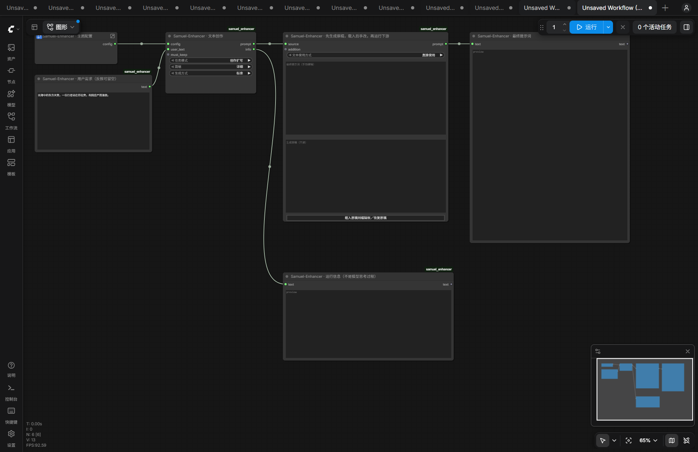

# Samuel-Enhancer

**把创作想法、参考图片或修改需求，整理成可以预览、手动编辑并接入生图工作流的提示词。**

ComfyUI custom nodes for text prompt enhancement, reference-image description, and image-editing instructions.

可以按需要接入 OpenAI，或本地 llama.cpp 等服务提供的语言大模型；图片任务请使用支持视觉输入的模型。

[](https://github.com/KyberofChirrut/Comfyui-prompt-enhancer/releases)
[](LICENSE)

[下载安装包](https://github.com/KyberofChirrut/Comfyui-prompt-enhancer/releases/latest) · [使用指南](docs/USAGE.md) · [故障排查](docs/TROUBLESHOOTING.md) · [示例工作流](examples) · [更新记录](CHANGELOG.md)

## 它能做什么

- **文本创作**：把简短想法扩写为完整画面提示词，或忠实润色已有描述。
- **参考图反推**：依据图片描述可见内容，也可结合用户的新想法设计目标画面。
- **图片编辑指令**：明确修改目标、保持内容、关联变化和预期结果，交给下游编辑模型使用。
- **模板可控**：生图/反推与图片编辑使用独立生产模板，完整规则可直接查看和修改。
- **结果可改**：生成原稿可以只读预览，也可以载入编辑框修改后再传给文本编码器。
- **服务可选**：支持外部 OpenAI 兼容接口和官方 OpenAI 接口；参考图与编辑任务需要支持图片输入的模型。

它负责生成文本。实际生图、图片编辑、分辨率、采样器和负面提示词由你的下游工作流控制。对 MOSS-Image、FLUX、Krea 等工作流，可将输出接到相应文本编码器；不同模型对提示词长度、格式和语言的偏好仍需自行验证。



上图展示示例工作流的节点与连线，来自本地前端验证环境，不代表一次完整出图结果。

## 五步开始使用

1. 按下方方法安装，重启 ComfyUI 并刷新浏览器，搜索 `Samuel-Enhancer`。
2. 将 [examples/text-create.json](examples/text-create.json) 拖入 ComfyUI。
3. 双击配置子图，在 **LLM 服务配置**中填写基础地址和服务实际提供的模型 ID。
4. 在用户文本框中输入创作想法，运行工作流，在预览节点查看结果。
5. 把最终提示词的 `STRING` 输出接到生图工作流的文本编码节点；需要手改时先点击“载入原稿到编辑框／恢复原稿”。

首次运行建议使用文本任务与标准模式，先确认接口可用，再尝试图片任务和精确模式。

## 版本与环境

当前版本 **0.3.5**。全部 9 个节点统一采用 **Samuel-Enhancer** 名称与分类。插件不在 ComfyUI 内加载 LLM 权重；如果 LLM 部署在本机，其资源消耗仍由 LLM 服务承担。

需要能正常运行的 ComfyUI、numpy/Pillow，以及可访问的 LLM 服务。随包示例采用原生 Subgraph，要求支持子图的前端（1.24.3 或更新）；本轮前端实际验证版本为 1.57.4。接口与模型须支持 JSON Schema；图片任务还须支持视觉输入。离线检查和实际验证范围见 [验证记录](docs/VALIDATION-0.3.5.md)。

0.3.5 更新显示名称、注册 ID、配置端口类型及前端命名。通过浏览器导入 0.3.x 工作流时自动迁移节点和子图连线，保留服务设置、用户文本、编辑稿与模板手稿；迁移后保存即可使用新名称。API 调用方需重新导出 API 格式工作流，或更新 class_type 与配置端口类型。安装目录仍为 Comfyui-prompt-enhancer。

0.3.4 将最终正文各节也纳入 JSON Schema：模型分别返回各节内容，程序按固定顺序组装标题。字数生成指导预留 15% 余量，原有硬上限不变；精确模式复核时加入程序测得的草稿字数。保留 0.3.3 的观察协议修复、0.3.2 的预设切换与手稿保存，以及旧格式的严格兼容解析。

0.3.1 修复 llama/Qwen 返回 `Composition: 正文` 同行标题时被误判为缺节的问题，兼容常见 Markdown 与编号标题并规范化输出。真正缺节、重复、顺序错误、空小节和超限仍会阻止输出，无额外模型调用。

0.1/0.2 的旧单体节点已移除，对应工作流需换用本版示例。旧的长篇规则、场景案例及 skeleton/modules/medium 控件不再参与运行。

## 安装

### Git 安装

在 `ComfyUI/custom_nodes` 目录执行：

```bash
git clone https://github.com/KyberofChirrut/Comfyui-prompt-enhancer.git Comfyui-prompt-enhancer
```

使用**运行 ComfyUI 的同一个 Python 环境**安装依赖：

```bash
python -m pip install -r Comfyui-prompt-enhancer/requirements.txt
```

完成后重启 ComfyUI。Windows 便携版请按下方命令使用其内置 Python。

### ZIP 安装

1. 将发布包中的 `Comfyui-prompt-enhancer` 目录放入 `ComfyUI/custom_nodes/`。升级时覆盖同名目录内容，避免嵌套两层，不要同时安装两个插件副本。
2. 使用运行 ComfyUI 的 Python 安装依赖：

   ```powershell
   .\python_embeded\python.exe -m pip install -r .\ComfyUI\custom_nodes\Comfyui-prompt-enhancer\requirements.txt
   ```

   虚拟环境用户执行 `python -m pip install -r requirements.txt`。常规 ComfyUI 通常已有 numpy/Pillow，不需要 OpenAI SDK。
3. 重启后端并刷新浏览器，搜索 **Samuel-Enhancer**。
4. 导入 `examples/` 中的 JSON。示例包含原生配置子图，要求支持 Subgraph 的 ComfyUI 前端（1.24.3 或更新）。ZIP 是安装包，JSON 才是工作流。
5. 双击配置子图，填写服务地址与实际模型 ID。默认地址为 `http://127.0.0.1:8000/v1`，模型留空，必须自行填写。

升级时，Git 安装可在插件目录执行 `git pull`；有手动修改的文件时请先处理本地改动。ZIP 安装覆盖同名目录即可。重启后端并按 Ctrl+F5 刷新前端，避免旧扩展缓存。

## 日常流程

```text
配置子图 ──────┐
用户文本框 ────┼→ 独立任务节点 → 提示词编辑与预览 → 下游文本编码/编辑工作流
保持项，可选 ──┤              └→ 运行信息预览
参考图片 ──────┘
```

图片仅在参考图和图片编辑任务中必需。三个任务节点彼此独立，不提供任务结果串联协议。负面词由下游原有工作流处理，插件不生成、扩展或透传负面词。

## 选择任务节点

| 节点 | 模式 | 用户文本 | 输出 |
|---|---|---|---|
| Samuel-Enhancer · 文本创作 | 创作扩写 / 忠实润色 | 创作想法或已有画面描述 | 六节完整生图提示词 |
| Samuel-Enhancer · 参考图反推 | 忠实反推 / 参考图创作 | 观察重点可留空；参考图创作必须填写想法 | 六节完整生图提示词 |
| Samuel-Enhancer · 图片编辑 | 受控编辑 | 明确修改要求 | 四节编辑指令 |

模式由下拉框明确选择，不根据文字长短自动切换。`user_text` 与可选 `must_keep` 均为外部 STRING 接口，主节点没有大段文字编辑框。可以使用随包的“文本输入”节点，也兼容其他 STRING 文本节点。

- 创作扩写：主动完成未指定的视觉设计，保留明确要求。
- 忠实润色：保留已有设计，改善表达、组织和清晰度。
- 忠实反推：实际图片是视觉证据，文字提供观察重点，不替换原图事实。
- 参考图创作：根据图片与新想法设计新画面，明确保持项决定保留哪些特征。
- 图片编辑：输出基于原图的修改指令，不执行图片编辑；下游必须支持原图和编辑指令输入，不能误当成已修改的图像。

保持项可直接写在用户需求中，无需重复填写。独立接口用于突出或复用约束。图像模式只接受单张 `[1,H,W,3]` IMAGE，MASK 与多图 batch 不参与本版任务；多图会报错，不静默丢图。

## 配置子图

每份示例的子图内包括：

- **LLM 服务配置**：地址、模型、协议、密钥环境变量名、token预算、超时、图片最长边、温度与高级参数。
- **模板预设编辑器**：完整预设正文与任务适配规则，均可直接修改并随工作流保存。
- **任务配置**：合并服务和模板，设置输出语言、输出优先级及重新扩写编号；输出一个 `SAMUEL_ENHANCER_CONFIG` 接口。

生图配置可供文本和参考图任务复用；编辑任务使用 editing 模板。类型不匹配会在请求前阻止运行。

### 模板编辑

`generation` 与 `editing` 分别对应用户确认的两份生产终版，运行文件位于 `templates/presets/`，批准基线位于 `docs/presets/`。

选择预设后自动切换正文与适配规则；第一次载入默认内容，之后切回时恢复该预设的手稿。两份手稿均随工作流保存，重新打开后仍可切换恢复。已有工作流升级后保留当前模板内容，不自动重置。

**恢复当前预设默认内容（覆盖当前手稿）** 按钮只重置当前预设，不影响另一份手稿。载入中保持原有名称和正文一致；失败时保留原稿并在状态栏显示错误，不会悄悄切换类型。

如果旧工作流曾只切换名称而未载入，导致正文与名称不一致，升级后可显式恢复当前预设默认内容一次。恢复会替换当前手稿，请按需要使用。

“任务适配规则”完整显示并可编辑，负责显式任务模式、参考图创作及画幅边界。执行设置中的语言、篇幅和响应封装协议由程序提供，不隐式加载旧案例或其他创作模板。

### 服务与密钥

- `local`：从 ComfyUI 后端访问配置的基础地址；`auto` 默认使用 Chat Completions。
- `openai`：固定使用官方基础地址；`auto` 默认使用 Responses。
- `api_key_env` 填环境变量名，不能填实际密钥。空值时 local 读取 `SAMUEL_ENHANCER_API_KEY`（可以没有），openai 读取 `OPENAI_API_KEY`（必需）。
- 配置节点不读取密钥，不发请求；运行任务时才读取后端环境变量。工作流、运行信息和错误正文不包含密钥。
- local 不会自动读取官方密钥；拒绝 HTTP 重定向，不自动重试。
- 升级时，如果曾配置旧默认的本地密钥环境变量，可将其改名为 `SAMUEL_ENHANCER_API_KEY`，或在 `api_key_env` 显式填写现有变量名。显式填写的变量名随旧工作流迁移保留。
- 服务地址可以有代理前缀，不应包含 `/chat/completions` 或 `/responses` 后缀。容器中的 localhost 指容器本身。

高级 JSON 支持 `top_p`、`presence_penalty`、`frequency_penalty`、`seed`、`stop`、`reasoning_effort`、`reasoning`、`chat_template_kwargs`、`top_k`、`min_p`；服务是否支持需自行确认。不能覆盖消息、模型、地址、密钥或输出预算。

0.3.3 起要求选定接口和模型支持 JSON Schema 结构化输出。程序按阶段设置 Chat Completions 的 `response_format` 或 Responses 的 `text.format`；无需在高级 JSON 中填写。服务不支持时会停止，不自动降级或重试。支持方式见 [OpenAI 官方文档](https://developers.openai.com/api/docs/guides/structured-outputs) 与 [llama.cpp 服务文档](https://github.com/ggml-org/llama.cpp/blob/master/tools/server/README.md)。

对于当前验证过的 llama.cpp / Qwen 服务，建议用以下高级 JSON 关闭思考，减少思考占满输出额度的问题：

```json
{"chat_template_kwargs": {"enable_thinking": false}}
```

这是该服务的参数，不应直接套用于所有服务。`max_output_tokens` 可先保持 4096；复杂输入仍提示截断时再增大。关闭思考不取消节点的三阶段精确模式。

如果优先处理复杂约束并接受较长耗时，可以将 `enable_thinking` 改为 `true`，单次输出预算先试 16384；输入和输出须能容纳于服务实际开放的上下文。输出预算是上限，不要求生成满，也不放宽最终正文篇幅。

图片按比例缩小后在内存中转 JPEG，只发送给选定服务，不另存副本，不修改原张量。

## 语言、篇幅和分辨率

默认英文，可在任务配置中改中文。默认 `prefer_input` 时识别常见明确语言要求（例如“用中文输出”）；`node_controls` 时以控件语言为准。歧义语言表达请用控件明确指定。画内指定文案保留原文。

| 篇幅 | 中文正文上限 | 英文正文上限 |
|---|---:|---:|
| 详细（默认） | 1500 个汉字 | 800 个英文词 |
| 简单 | 750 个汉字 | 400 个英文词 |

不设最低字数，不为凑长度补写。统计不含小节标题；英文按单词计数，汉字不含标点。最终格式不合格或超过上限会停止，不截断、不追加修复调用。可重新生成，或在有效正文基础上手动编辑。用户的其他字数要求不放宽档位硬上限。

0.3.4 的执行指导使用硬上限的 85% 作为工作上限：例如详细中文 1275 汉字、英文 680 词，给模型计数误差留余量。这不是最低长度，也不会取代 1500/800 的最终硬上限。精确模式的现有复核调用会收到程序测得的草稿字数；复核后若仍超长，继续停止，不额外调用或截断。

任务配置有可选 `target_width` / `target_height` 接口，均为 0 表示未指定。需要时可在子图中将这两个接口暴露到外部，连接下游同一份宽高数据。它们只指导构图，实际尺寸由下游 Latent、缩放或编辑工作流控制。忠实反推仍保留原图构图。

`image_max_side` 只控制发送给 LLM 的图像尺寸，与最终出图分辨率不同。

## 标准、精确与失败行为

- **标准**：一次调用，在结构化响应中返回最终正文和冲突状态。
- **精确**：观察/约束 → 生成 → 带实际原图复核，共三次调用。原图在每次图片请求中重复提供。
- 可确定的缺图、空输入、错误模板等在请求前检查。语义歧义和硬冲突由模型记录/报告，不能保证发现所有问题。
- 模型报告的未解决硬冲突、格式错误、截断、网络错误或复核失败阻止正文进入下游，不回退未经复核草稿。
- 模型的 JSON 仅是内部传输封装。最终响应中的 `prompt` 为六节或四节正文的字段对象，由程序补上英文标题并排序；节点的 `prompt` 输出仍是普通 STRING，不含 JSON、错误状态或分析过程。服务若返回旧式正文字符串，仍须通过完整标题与篇幅检查，不猜测缺失标题。
- 参考图观察和模型复核可能有误；`model_reviewed` 表示执行过模型复核，不代表生成图像或编辑效果已经验证。
- token预算与超时分别适用于每次请求，精确模式总用量更高。取消在每次请求前后检查，已发出的远端推理未必立即取消。

## 手动编辑与预览

“文本预览”为只读透传；“提示词编辑与预览”提供三种方式：

1. **直接使用**：输出生成原稿。
2. **完整编辑**：先生成原稿，点击“载入原稿到编辑框／恢复原稿”，手改正文，再执行下游。输出编辑框完整内容。
3. **追加补充**：将外部文本框接到可选 `addition` 接口，原稿后附加补充文字。只做拼接，不调用模型消除语义冲突。

上游新结果只更新原稿预览，绝不自动覆盖手稿。手稿及最近原稿随工作流保存。编辑后需再次执行才能更新下游输出；点击按钮不会自动提交生图。

编辑节点本身不调用 LLM。输入和缓存不变时，上游通常复用 ComfyUI 缓存；缓存因重启或清理丢失时，上游可能重新请求。要永久固定提示词，可复制到独立文本输入节点后断开 LLM 分支。

手动编辑节点输出不再强制六节/四节和篇幅校验，便于自由改写。修改内容是否适合下游由用户决定。

## 重新扩写与输出

`refresh_id` 是重新扩写编号，不作为模型 seed 发送。输入、模板或配置变化会使任务重新执行；只改下游生图 seed 不主动刷新 LLM。标准缓存不保证跨会话保留。

- `prompt`：标准 STRING，接预览或下游文本编码；不能直接接采样器的 CONDITIONING。
- `info`：任务、有效设置、字数、耗时、阶段、用量、模板/运行指纹及提醒。不是模型思考过程。

## 示例与验证

`examples/` 包括 `text-create`、`text-refine`、`reference-describe`、`reference-create`、`image-edit`、`reference-precise`、`text-openai`。修改配置子图内的模型和地址后使用，图片任务选择自己的参考图。

```powershell
python -m unittest discover -s tests -p 'test_*.py' -v
node tests/test_preview.mjs
node tests/test_editor.mjs
node tests/test_migration.mjs
```

离线测试使用回环 HTTP 服务与模拟响应，不调用外部模型。真实联调可通过手动运行 `tools/smoke.py` 进行。当前命名与工作流迁移验证见 `docs/VALIDATION-0.3.5.md`；历史推理记录不代表完整出图验收。

## 反馈与授权

遇到问题请在 [Issues](https://github.com/KyberofChirrut/Comfyui-prompt-enhancer/issues) 提供插件/ComfyUI 版本、任务模式、报错阶段、接口类型及脱敏后的错误文字。请删除 API Key、私人图片、敏感提示词和内部服务地址。

项目采用 [MIT License](LICENSE)，允许使用、修改和再分发，需保留许可证及版权声明。模型服务、模型权重和第三方节点各自的许可及使用费用由相应提供方决定。
